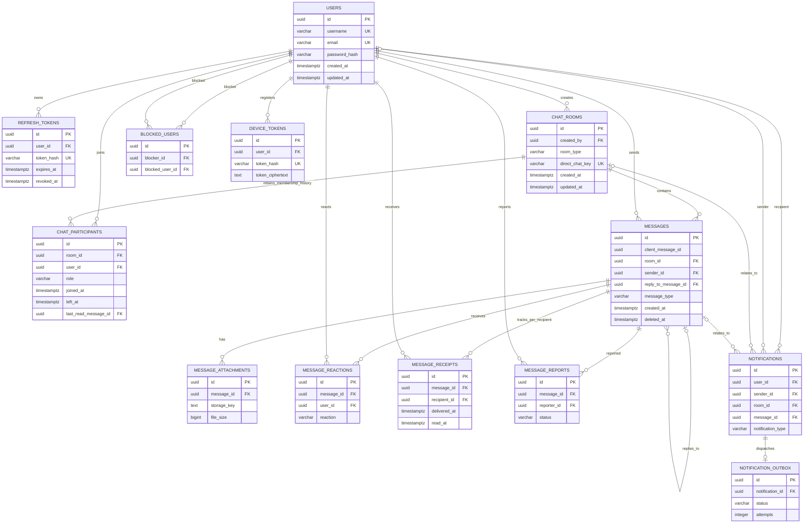

# Chat persistence contract

The PostgreSQL schema is created by `src/main/resources/db/migration/V1__create_chat_schema.sql`.
Flyway is authoritative; Hibernate remains in `ddl-auto: validate` mode. IDs are UUIDs
generated in the application, and event timestamps use `TIMESTAMPTZ`/UTC.

## Tables and purpose

| Table | Purpose and important constraints |
|---|---|
| `users` | User identity/profile. Case-insensitive unique indexes on username and email; password hash may be null for OAuth-only accounts. |
| `refresh_tokens` | Hashed refresh-token records, expiry and revocation. Token hash is unique; users with retained tokens cannot be hard-deleted. |
| `chat_rooms` | Private/group conversation metadata. Private rooms require a unique sorted-pair `direct_chat_key`; group rooms must not have one. |
| `chat_participants` | Membership history and participant settings/read cursor. A partial unique index allows at most one active row per room/user while retaining left rows. |
| `messages` | Text/system/media message metadata, reply link, edit/delete state, and client idempotency key. `(sender_id, client_message_id)` is unique; history index is `(room_id, created_at DESC, id DESC)`. |
| `message_attachments` | Object-storage metadata only (`storage_key`, type, size and safe filename); no file bytes are stored in PostgreSQL. |
| `message_reactions` | Per-user reactions; unique by message, user and reaction. |
| `message_receipts` | Per-recipient delivery/read timestamps; one row per message/recipient. Rows are written on delivery/read events, not pre-created for every room member. |
| `blocked_users` | Directional block relationship; unique blocker/blocked pair and no self-block. |
| `message_reports` | User reports and review status; one report per reporter/message. |
| `notifications` | In-app notification and optional sender/room/message navigation references. |
| `device_tokens` | Multi-device notification targets. Store a token hash for deduplication and encrypted token ciphertext for dispatch; encryption key management belongs in application configuration. |
| `notification_outbox` | One dispatch state per notification, with attempt and retry scheduling metadata. FCM acceptance is not a device-delivery receipt. |

Column types, nullability, defaults, checks, foreign keys and indexes are defined in the
Flyway SQL migration; this table is the compact data dictionary, not a second schema source.

## ER diagram

## Field-level data dictionary

`NOT NULL` and defaults below are explicit in the migration. Primary keys are UUIDs
generated by Kotlin/JPA unless indicated otherwise.

| Table | Fields (PostgreSQL type; nullability/default; key or reference) |
|---|---|
| `users` | `id UUID PK`; `username VARCHAR(50) NOT NULL`; `email VARCHAR(255) NOT NULL`; `password_hash VARCHAR(255) NULL`; `full_name VARCHAR(100) NULL`; `profile_picture_url TEXT NULL`; `bio VARCHAR(500) NULL`; `is_active BOOLEAN NOT NULL DEFAULT true`; `last_seen_at TIMESTAMPTZ NULL`; `created_at, updated_at TIMESTAMPTZ NOT NULL DEFAULT now()`. Username/email have case-insensitive unique indexes. |
| `refresh_tokens` | `id UUID PK`; `user_id UUID NOT NULL FK users(id)`; `token_hash VARCHAR(255) NOT NULL UNIQUE`; `expires_at TIMESTAMPTZ NOT NULL`; `revoked_at TIMESTAMPTZ NULL`; `created_at TIMESTAMPTZ NOT NULL DEFAULT now()`. |
| `chat_rooms` | `id UUID PK`; `name VARCHAR(100) NULL`; `room_type VARCHAR(10) NOT NULL`; `description VARCHAR(500) NULL`; `group_picture_url TEXT NULL`; `created_by UUID NOT NULL FK users(id)`; `direct_chat_key VARCHAR(100) NULL UNIQUE`; `created_at, updated_at TIMESTAMPTZ NOT NULL DEFAULT now()`. Check constraints couple room type to key nullability. |
| `chat_participants` | `id UUID PK`; `room_id, user_id UUID NOT NULL FK chat_rooms/users`; `role VARCHAR(10) NOT NULL DEFAULT 'MEMBER'`; `joined_at TIMESTAMPTZ NOT NULL DEFAULT now()`; `left_at, last_read_at TIMESTAMPTZ NULL`; `last_read_message_id UUID NULL FK messages(id)`; `is_muted, is_archived BOOLEAN NOT NULL DEFAULT false`; audit timestamps `TIMESTAMPTZ NOT NULL DEFAULT now()`. Partial unique index permits one active membership per room/user. |
| `messages` | `id UUID PK`; `client_message_id UUID NOT NULL`; `room_id UUID NOT NULL FK chat_rooms(id)`; `sender_id UUID NOT NULL FK users(id)`; `content TEXT NULL`; `message_type VARCHAR(10) NOT NULL`; `reply_to_message_id UUID NULL FK messages(id)`; `is_edited BOOLEAN NOT NULL DEFAULT false`; `edited_at, deleted_at TIMESTAMPTZ NULL`; audit timestamps `TIMESTAMPTZ NOT NULL DEFAULT now()`. Unique `(sender_id, client_message_id)`. |
| `message_attachments` | `id UUID PK`; `message_id UUID NOT NULL FK messages(id)`; `file_name VARCHAR(255) NOT NULL`; `storage_key TEXT NOT NULL`; `file_type VARCHAR(100) NOT NULL`; `file_size BIGINT NOT NULL CHECK >= 0`; `created_at TIMESTAMPTZ NOT NULL DEFAULT now()`. |
| `message_reactions` | `id UUID PK`; `message_id, user_id UUID NOT NULL FK messages/users`; `reaction VARCHAR(20) NOT NULL`; `created_at TIMESTAMPTZ NOT NULL DEFAULT now()`; unique `(message_id, user_id, reaction)`. |
| `message_receipts` | `id UUID PK`; `message_id, recipient_id UUID NOT NULL FK messages/users`; `delivered_at, read_at TIMESTAMPTZ NULL`; audit timestamps `TIMESTAMPTZ NOT NULL DEFAULT now()`; unique `(message_id, recipient_id)`; a read timestamp requires delivery timestamp. |
| `blocked_users` | `id UUID PK`; `blocker_id, blocked_user_id UUID NOT NULL FK users(id)`; `created_at TIMESTAMPTZ NOT NULL DEFAULT now()`; unique pair and no-self-block check. |
| `message_reports` | `id UUID PK`; `message_id UUID NOT NULL FK messages(id)`; `reporter_id UUID NOT NULL FK users(id)`; `reason VARCHAR(100) NOT NULL`; `description TEXT NULL`; `status VARCHAR(10) NOT NULL DEFAULT 'PENDING'`; `created_at TIMESTAMPTZ NOT NULL DEFAULT now()`; `reviewed_at TIMESTAMPTZ NULL`; unique `(message_id, reporter_id)`. |
| `notifications` | `id UUID PK`; `user_id UUID NOT NULL FK users(id)`; `sender_id UUID NULL FK users(id)`; `room_id UUID NULL FK chat_rooms(id)`; `message_id UUID NULL FK messages(id)`; `title VARCHAR(255) NOT NULL`; `body TEXT NULL`; `notification_type VARCHAR(30) NOT NULL`; `is_read BOOLEAN NOT NULL DEFAULT false`; `created_at TIMESTAMPTZ NOT NULL DEFAULT now()`. |
| `device_tokens` | `id UUID PK`; `user_id UUID NOT NULL FK users(id)`; `token_hash VARCHAR(64) NOT NULL UNIQUE`; `token_ciphertext TEXT NOT NULL`; `platform VARCHAR(20) NOT NULL`; `is_active BOOLEAN NOT NULL DEFAULT true`; audit timestamps `TIMESTAMPTZ NOT NULL DEFAULT now()`. |
| `notification_outbox` | `id UUID PK`; `notification_id UUID NOT NULL UNIQUE FK notifications(id)`; `status VARCHAR(10) NOT NULL DEFAULT 'PENDING'`; `attempts INTEGER NOT NULL DEFAULT 0 CHECK >= 0`; `next_attempt_at TIMESTAMPTZ NOT NULL DEFAULT now()`; `last_error TEXT NULL`; audit timestamps `TIMESTAMPTZ NOT NULL DEFAULT now()`. |

## Relationship and lifecycle notes

- Users own refresh tokens, memberships, authored messages, reactions, receipts, reports,
  blocks, notifications and device tokens. `ON DELETE RESTRICT` protects historical records.
- Rooms have membership history and messages. Room deletion is restricted while messages or
  memberships exist; normal conversation removal should be represented by membership state,
  not a cascading delete.
- Message replies use a self-reference with `ON DELETE SET NULL`. Attachments, reactions and
  receipts cascade only on a deliberate hard purge of a message. Reports restrict that purge;
  notifications survive with nullable references set to null.
- A private-room row's participant cardinality (exactly two active users) and sorted UUID
  direct key are service invariants in addition to the unique key constraint.
- Reply targets and read-cursor messages must belong to the same room as the referencing
  message or participant. This cross-row invariant is validated by the service layer.
- Membership rejoining inserts a new row after the previous row receives `left_at`; it does
  not overwrite membership history. `left_at IS NULL` means active.
- Read/unread state is based on the `(created_at, id)` message cursor per participant.
  `MessageRepository` exposes before/after keyset queries and a cursor-based unread count.
  Callers should use page zero with a bounded page size; do not use offsets for conversation
  history.
- Message deletion is soft deletion for everyone (`deleted_at`). REST/WebSocket projections
  must mask content of deleted messages. Delete-for-me is not in this schema; it would need
  a separate per-user message visibility table.

## Migration and rollback

V1 creates the initial schema and is additive. Do not edit an applied Flyway migration;
subsequent changes require a new versioned migration. Production rollback should use a
reviewed compensating migration or a verified backup, not an automatic `DROP TABLE` script.
Before applying to an existing installation, take a database backup and verify that it has
no conflicting table names.

## Validation

`PersistenceRepositoryIntegrationTests` exercises case-insensitive uniqueness, membership
history, sender idempotency, cursor-based unread counts, and before/after message pagination.
The tests use the configured PostgreSQL datasource and run inside rollback transactions.
